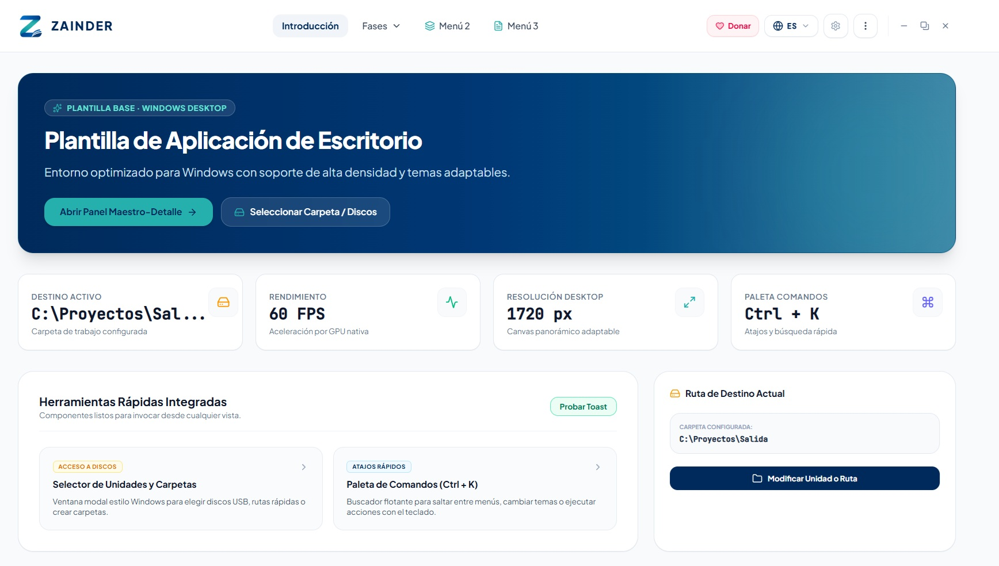
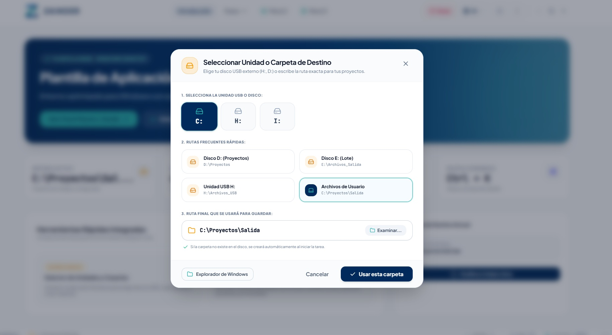
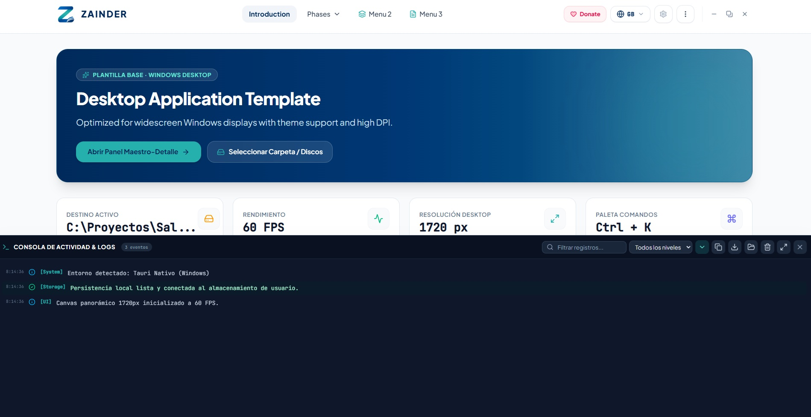

# 🚀 Zainder Template — Professional Windows Desktop Application Template

> **Production‑ready desktop boilerplate for Windows**, powered by **Tauri v2** (the current stable major release), **Rust**, **React 19**, **TypeScript**, and **Tailwind CSS v4**.

**Zainder Template** eliminates out‑of‑the‑box the classic pitfalls, configuration friction, and elusive runtime bugs encountered when starting a modern Windows desktop project from scratch with Tauri v2.

_Note_: This template is based on **Tauri v2**; when **Tauri v3** is released, an updated version of the template will be prepared.

---

## 📸 Screenshots

| Portada Principal | Selector de Discos y Carpetas | Consola de Logs en Disco |
| :---: | :---: | :---: |
|  |  |  |

---

## 📋 Table of Contents
1. [What is Zainder Template?](#-what-is-zainder-template)
2. [Out-of-the-Box Solutions to Critical Desktop Issues](#-out-of-the-box-solutions-to-critical-desktop-issues)
   - [Frameless Window & Fluid Native Dragging](#1-frameless-window--fluid-native-dragging)
   - [Titlebar Double-Click in Tauri v2](#2-titlebar-double-click-in-tauri-v2)
   - [Portable Standalone (.exe) Instant Double-Click Launch](#3-portable-standalone-exe-instant-double-click-launch)
   - [Clean NSIS Installer & Uninstaller](#4-clean-nsis-installer--uninstaller)
   - [Cargo Build I/O Locking (os error 32)](#5-cargo-build-io-locking-os-error-32)
   - [Single-Instance Lock](#6-single-instance-lock)
3. [Architecture & Pre-Installed Modules](#-architecture--pre-installed-modules)
   - [Transparent Native Abstraction Layer (`nativeApi.ts`)](#transparent-native-abstraction-layer-nativeapits)
   - [Drive & Directory Selector Modal](#drive--directory-selector-modal)
   - [Silent Windows File Explorer Launch](#silent-windows-file-explorer-launch)
   - [True AppData Persistence (`%APPDATA%`)](#true-appdata-persistence-appdata)
   - [Real-Time Activity Log Console & Disk Logging](#real-time-activity-log-console--disk-logging)
   - [Native Windows Desktop Notifications](#native-windows-desktop-notifications)
   - [Command Palette (`Ctrl + K`) & Global Keyboard Shortcuts](#command-palette-ctrl--k--global-keyboard-shortcuts)
   - [Tailwind CSS v4 Design System & Accessibility](#tailwind-css-v4-design-system--accessibility)
   - [Multi-Language Internationalization (i18n)](#multi-language-internationalization-i18n)
4. [Project Directory Structure](#-project-directory-structure)
5. [Rebranding the Template in 2 Seconds](#-rebranding-the-template-in-2-seconds)
6. [Quick Command Reference](#-quick-command-reference)
7. [License](#-license)

---

## 🎯 What is Zainder Template?

**Zainder Template** is an enterprise-grade architectural foundation designed for software developers who need to ship robust, high-performance desktop software for Windows (such as conversion tools, analytics dashboards, media processors, offline utilities, or SaaS client wrappers) without wasting days troubleshooting native OS bridges.

### Key Highlights:
- **Transparent Dual Environment**: Develop and preview 100% of your user interface in your web browser (`npm run dev` at `http://localhost:3000`) with built-in mocks. When bundled via Tauri (`npm run tauri:build`), the exact same React code connects automatically to native Rust APIs and Windows subsystems without requiring any code changes.
- **Hardware-Accelerated 60 FPS Performance**: Widescreen 1720px responsive canvas optimized for Microsoft Edge WebView2 runtime.
- **Dual Deliverables**: Generates both an NSIS installer with verified uninstallation hooks and an ultra-lightweight standalone portable `.exe` (~11.2 MB) that launches instantly with zero installation footprint.

---

## 🛡️ Out-of-the-Box Solutions to Critical Desktop Issues

### 1. Frameless Window & Fluid Native Dragging
Default OS titlebars look outdated and constrain design. Zainder Template ships configured with `"decorations": false` in `src-tauri/tauri.conf.json`.
- **Top Navigation Drag Region**: [Navbar.tsx](src/components/Navbar.tsx) exposes the top navigation bar with the `data-tauri-drag-region` attribute.
- **Rust-Delegated Dragging**: The navigation bar listens to `onMouseDown` on neutral areas and calls `nativeApi.startDragging()`, delegating physics and motion handling directly to Windows's native `app_start_dragging` API to prevent mouse desync.
- **Native Window Controls**: [WindowControls.tsx](src/components/ui/WindowControls.tsx) provides custom Minimize, Maximize/Restore, and Close buttons wired to native Rust commands (`app_minimize`, `app_toggle_maximize`, `app_close`, `app_is_maximized`).

### 2. Titlebar Double-Click in Tauri v2
> **The Problem**: In custom frameless titlebars, double-clicking to maximize or restore often conflicts with the drag gesture (`start_dragging`) or fails to register in Windows.

**The Solution in Zainder Template:**
In [Navbar.tsx](src/components/Navbar.tsx#L119-L125), the titlebar intercepts double-clicks cleanly:
```tsx
const handleBarDoubleClick = (e: React.MouseEvent) => {
  const target = e.target as HTMLElement;
  if (!target.closest('button, input, select, a, [role="button"]')) {
    nativeApi.toggleMaximizeWindow();
  }
};
```
This enables instantaneous, native-feeling maximize/restore behavior while ensuring interactive controls remain unaffected.

### 3. Portable Standalone (.exe) Instant Double-Click Launch
> **The Problem**: Compiling a standalone portable executable with Tauri frequently results in binaries that either fail to open on double-click or unexpectedly trigger Windows UAC ("Run as Administrator") prompts.

**Root Causes Fixed:**
1. **Zero Invasive Startup Hooks**: Startup routines attempting to write to the desktop, create shortcuts via PowerShell, or query the registry were removed from `src-tauri/src/lib.rs`.
2. **Standard `asInvoker` UAC Manifest**: The portable binary runs strictly under standard user privileges without requesting administrative elevation.
3. **Pure Standalone Binary**: The standalone executable is located at `src-tauri/target/release/zainder.exe` (~11.2 MB), ready for instant distribution and double-click execution.

### 4. Clean NSIS Installer & Uninstaller
> **The Problem**: If an application remains open or an orphaned WebView2 sub-process is active during uninstallation, Windows NSIS aborts with *"File in use by another process"*, corrupting the uninstallation and leaving orphaned files behind.

**The Solution in `src-tauri/windows/hooks.nsh`:**
Zainder Template implements automated lifecycle NSIS macros:
- **`NSIS_HOOK_PREINSTALL`**: Proactively terminates any previously running instances (`taskkill /F /IM Zainder.exe /T`) before copying or updating files.
- **`NSIS_HOOK_POSTINSTALL`**: Prompts the user (`MessageBox MB_YESNO`) before creating a desktop shortcut (`Zainder.lnk`).
- **`NSIS_HOOK_PREUNINSTALL`**: Forcefully terminates any remaining active application or WebView processes before file removal.
- **`NSIS_HOOK_POSTUNINSTALL`**: Deletes shortcuts from `$DESKTOP` and `$SMPROGRAMS`, followed by an exhaustive recursive wipe of `$INSTDIR`.
- **Dual Installation Mode (`installMode: "both"`)**: Users can choose between installing *per-user* (into `AppData\Local\Programs\...`, requiring zero UAC prompts) or *system-wide* (`Program Files`).

### 5. Cargo Build I/O Locking (`os error 32`)
> **The Problem**: During release builds, Windows Defender or search indexing services frequently lock temporary `.rmeta` and `.o` files generated concurrently by Cargo, resulting in `The process cannot access the file because it is being used by another process (os error 32)`.

**Recommended Safe Compilation Procedure:**
Run the build with a capped job concurrency limit:
```powershell
$env:CARGO_BUILD_JOBS="4"; cargo build --release --manifest-path src-tauri/Cargo.toml
```

### 6. Single-Instance Lock
Powered by `tauri-plugin-single-instance`. If a user attempts to launch the application while an instance is already running, the new process does not duplicate windows or resources; it brings the existing window to the foreground, restoring it from minimized state automatically.

---

## 🧩 Architecture & Pre-Installed Modules

### Transparent Native Abstraction Layer (`nativeApi.ts`)
Located in [src/services/nativeApi.ts](src/services/nativeApi.ts). Acts as the bridge between React and Rust:
- `nativeApi.openDirectoryDialog(defaultPath)`: Launches the native Windows directory picker dialog.
- `nativeApi.openInExplorer(path)`: Opens Windows File Explorer at the designated path.
- `nativeApi.getAvailableDisks()`: Queries connected physical and removable drives (`C:`, `D:`, `E:`, `H:`, USBs).
- `nativeApi.saveSettingsToDisk(settings)`: Persists application settings to `%APPDATA%\settings.json`.
- `nativeApi.loadSettingsFromDisk()`: Restores configuration upon startup.
- `nativeApi.sendNativeNotification(title, body)`: Triggers Windows toast notifications in the background.
- `nativeApi.writeLogToDisk(level, source, message)`: Writes timestamped events to daily rotating log files.
- `nativeApi.minimizeWindow()`, `toggleMaximizeWindow()`, `closeWindow()`, `startDragging()`.

### Drive & Directory Selector Modal
Component [DirectorySelectorModal.tsx](src/components/DirectorySelectorModal.tsx):
- **Drive Selector Pills**: Direct access to `C:`, `D:`, `E:`, `H:`, `F:`, `G:`.
- **Quick Path Presets**: Projects, Batch Output, External USB, and User Documents.
- **Editable Path Field**: Allows manual typing or pasting of any custom Windows path.
- **Native Browse Button**: Triggers `tauri-plugin-dialog` native folder selection.
- **Global Hotkey**: Press `Ctrl + O` from anywhere in the app to open the selector instantly.

### Silent Windows File Explorer Launch
The `open_path_in_explorer` command in [src-tauri/src/lib.rs](src-tauri/src/lib.rs) executes `explorer.exe` with the Windows creation flag `0x08000000` (`CREATE_NO_WINDOW`), preventing black CMD command prompt flashes when opening folders.

### True AppData Persistence (`%APPDATA%`)
Unlike web applications that lose state when clearing browser storage, Zainder Template persists configuration directly to the Windows file system:
```
%APPDATA%\com.garba.zainder\settings.json
```
- Automatically stores selected language, active theme, font sizing, and accessibility modes.
- Restores settings during early startup before the initial render.

### Real-Time Activity Log Console & Disk Logging
Component [LogDrawer.tsx](src/components/ui/LogDrawer.tsx) (toggleable via `Ctrl + \`` or the bottom status bar):
- Categorized event streaming (`info`, `success`, `warn`, `error`) with timestamps and sources.
- Visual background task progress bar with an interactive **"Abort"** cancel button.
- **Daily Disk Persistence**: Warning and error logs are automatically saved to:
  `%APPDATA%\com.garba.zainder\logs\YYYY-MM-DD.log`
- Direct **"Open Logs Folder"** button to view log files in Windows File Explorer.
- Copy to clipboard, export to `.log`, and auto-scroll pause controls.

### Native Windows Desktop Notifications
Integrated via `tauri-plugin-notification`. Delivers background toast notifications to the Windows Action Center when long-running batch operations finish, even while the application is minimized.

### Command Palette (`Ctrl + K`) & Global Keyboard Shortcuts
- **Floating Command Palette**: Component [CommandPalette.tsx](src/components/CommandPalette.tsx) providing fuzzy search for rapid view navigation, theme switching, and actions.
- **Global Hotkeys**:
  - `Ctrl + K`: Command Palette.
  - `Ctrl + O`: Destination Folder / Drive Selector.
  - `Ctrl + ,`: Settings & Accessibility.
  - `F1`: Keyboard Shortcuts Cheat Sheet ([ShortcutsModal.tsx](src/components/ShortcutsModal.tsx)).
  - `Ctrl + \`` or `Ctrl + J`: Activity & Log Console.
  - `Esc`: Dismiss active modal dialogs.

### Tailwind CSS v4 Design System & Accessibility
Built on **Tailwind CSS v4** featuring a tailored color palette:
- **Zainder Navy (`#002a5b`)** and **Technology Cyan (`#25b0ae`)**.
- **Midnight Navy Dark Mode (`#060b14` / `#0c1527`)**: High-contrast, sleek palette avoiding washed-out grays.
- **High-Contrast Accessibility Mode (A11y)**: Pure black `#000000` background paired with high-visibility luminous yellow `#facc15` borders.
- **Dynamic Font Scaling**: Small (16px), Standard (18px), and Large (20px) adjustable root font sizing.
- **Typography**: Google Fonts (*Plus Jakarta Sans* for UI, *JetBrains Mono* for paths and telemetry).

### Multi-Language Internationalization (i18n)
Managed in [src/i18n/interfaceTranslations.ts](src/i18n/interfaceTranslations.ts):
- Complete, type-safe translations for **Spanish (`es`)**, **English (`en`)**, **French (`fr`)**, and **German (`de`)**.
- Instant language switching directly from the top navigation dropdown without page reloads.

---

## 📁 Project Directory Structure

```
zainder-tauri2-template-windows/
├── index.html                   # HTML entry point with fonts & metadata
├── package.json                 # Dependencies & build scripts
├── scripts/
│   └── rename-app.js            # Automated 2-second project rebranding script
├── src/
│   ├── App.tsx                  # Root application component with view router
│   ├── index.css                # Tailwind CSS v4 tokens, themes & accessibility
│   ├── main.tsx                 # React 19 bootstrap entry
│   ├── components/
│   │   ├── Navbar.tsx           # Frameless draggable navigation header
│   │   ├── ZainderLogo.tsx      # Vector graphic Zainder brand logo
│   │   ├── DirectorySelectorModal.tsx  # Drive & folder selector modal
│   │   ├── CommandPalette.tsx   # Floating command palette (Ctrl + K)
│   │   ├── StatusBar.tsx        # Persistent bottom desktop status bar
│   │   ├── SettingsModal.tsx    # Preferences & AppData manager
│   │   ├── ShortcutsModal.tsx   # Keyboard shortcuts cheat sheet (F1)
│   │   ├── CreditsModal.tsx     # Version info & diagnostic ping test
│   │   ├── LicensePrivacyModal.tsx # MIT license & zero-telemetry policy
│   │   ├── DonationModal.tsx    # Project support modal
│   │   └── ui/
│   │       ├── WindowControls.tsx # Native Minimize, Maximize, Close buttons
│   │       ├── LogDrawer.tsx      # Real-time log drawer & task progress bar
│   │       ├── Toast.tsx          # Toast notification provider
│   │       ├── ConfirmModal.tsx   # Generic confirmation dialog
│   │       └── FileDropzone.tsx   # Drag-and-drop file ingestion zone
│   ├── i18n/
│   │   └── interfaceTranslations.ts # Type-safe ES, EN, FR, DE dictionaries
│   ├── services/
│   │   └── nativeApi.ts         # React <-> Rust abstraction bridge
│   └── utils/
│       ├── desktop.ts           # Tauri environment runtime detection
│       └── speech.ts            # Text-to-Speech audio utilities
├── src-tauri/
│   ├── Cargo.toml               # Rust dependencies & crate definitions
│   ├── tauri.conf.json          # Window configuration, NSIS settings & capabilities
│   ├── capabilities/
│   │   └── default.json         # Tauri v2 security permissions
│   ├── src/
│   │   ├── lib.rs               # Rust native command handlers & plugin registry
│   │   └── main.rs              # Windows binary entry point
│   └── windows/
│       └── hooks.nsh            # NSIS clean install/uninstall lifecycle hooks
└── GUIA_COMPILACION_WINDOWS.md  # Detailed Windows compilation manual (Spanish)
```

---

## 🏷️ Rebranding the Template in 2 Seconds

To rebrand Zainder Template for a new project, execute the automated rebranding script:

```powershell
npm run rename -- "MyNewApp" "com.mycompany.mynewapp"
```

This single command automatically updates:
1. `package.json` (package name, description, and author).
2. `src-tauri/tauri.conf.json` (window title, product name, identifier, and copyright).
3. `src-tauri/Cargo.toml` (crate package name and binary output).
4. `src-tauri/src/lib.rs` (shortcut strings and application runtime metadata).
5. `src-tauri/windows/hooks.nsh` (process termination names and desktop shortcuts).
6. `src/components/Navbar.tsx` (brand logo display label).

---

## ⚡ Quick Command Reference

### Frontend Development (Browser Mode with Fast HMR)
```powershell
npm run dev
```
Launches the development server at `http://localhost:3000` with active mock APIs.

### Native Desktop Development (Tauri v2 + WebView2)
```powershell
npm run tauri:dev
```
Compiles the Rust backend and opens the live application in its frameless native Windows window.

### Type Verification (TypeScript Lint)
```powershell
npm run lint
```

### Production Build (NSIS Setup + Portable Standalone)
```powershell
npm run tauri:build
```
Generates production-ready Windows deliverables:
- **NSIS Installer**: `src-tauri/target/release/bundle/nsis/Zainder_1.0.0_x64-setup.exe`
- **Portable Executable**: `src-tauri/target/release/zainder.exe`

---

## 📄 License
Distributed under the **MIT License**. Free for commercial and open-source use.
